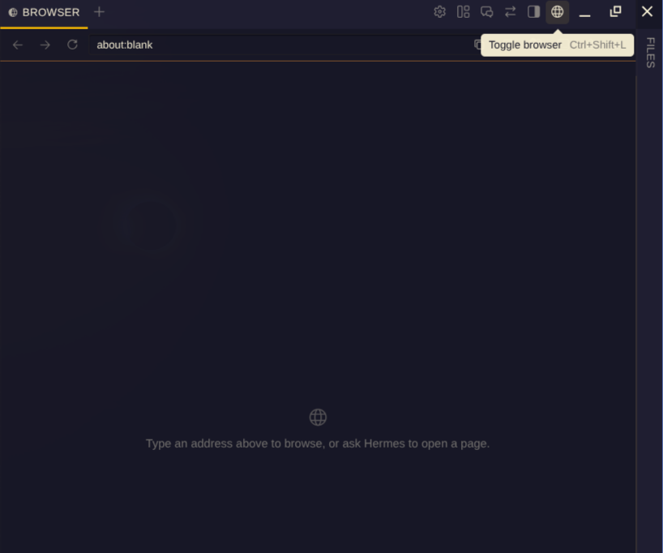

# browser-toggle

Hermes Desktop plugin: one button that opens/closes the built-in browser,
exactly what the `Ctrl+Shift+L` shortcut does (`view.showBrowser` →
`toggleBrowserTab()`). Nothing else.



## Why

I am trying to do everything inside the Hermes Desktop app, so having a button
for the built-in browser makes sense to me. The `Ctrl+Shift+L` keybinding works
great too; this is just the click version, and it takes almost no space (one
small icon in the titlebar). I hope it is useful to others.

## How it works

- **Where:** slot `titleBar.right`, inside the app's main top-right cluster
  (next to Settings / Layout / HUD mode). That cluster is `no-drag` and is
  reserved against the window-drag strip of the side panes.
- **Do not use `titleBar.tools.right`:** it is a separate cluster that is not
  reserved. With a right-hand pane open (e.g. brand-lean) the pane's drag strip
  covers the button: no hover, no tooltip, and a click drags the window.
- **Look:** built with the app's own `Button size="icon-titlebar"` and `Tip`,
  so size, hover and colors come from `var(--ui-*)` tokens. Icon: codicon
  `globe` (the app's own browser icon).
- **Language:** the label comes from the app's translation of the keybind
  (`t.keybinds.actions['view.showBrowser']`) via `useI18n`, so it follows the
  active UI language. The shortcut hint is shown next to it.
- **Action:** dispatches the shortcut's own chord on the window, so the app's
  keybind listener runs the native action. No browser logic of our own.

## Files

- `docs/screenshot.png`: screenshot used in this README.
- `desktop/plugin.js`: source of truth (plain ESM, no build step).
- `plugin.yaml`: catalog manifest.
- `SHA256SUMS`: source vs deployed copy.

## Install

Copy `desktop/plugin.js` to `~/.hermes/desktop-plugins/browser-toggle/plugin.js`, then
Ctrl+K → **Reload desktop plugins**.

## Verify

```bash
node --check desktop/plugin.js
sha256sum -c SHA256SUMS
cmp desktop/plugin.js ~/.hermes/desktop-plugins/browser-toggle/plugin.js
```

## Status

Deployed and checked by hand on ProDesk (Linux Mint) and ThinkPad 2900
(Omarchy), including with a right-hand pane open. Current sha256:
`35abd30bf879580fbe43cb0b097e91e35012a2a0501b2f2f27c1b45fa1565171`.
